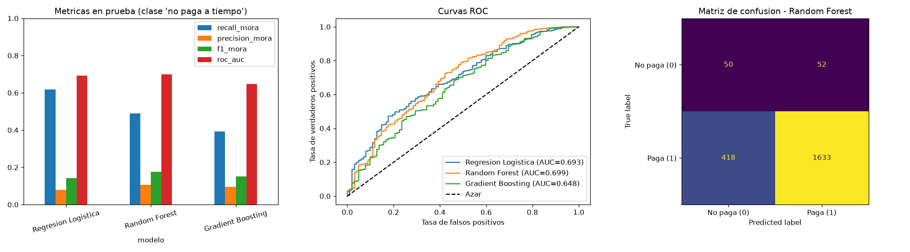

# Proyecto Final - Machine Learning 2026
## Predicción de pago a tiempo de créditos (MLOps)

Modelo supervisado que predice si un cliente pagará su crédito a tiempo (`Pago_atiempo`), con un pipeline reproducible, monitoreo de *data drift* y estructura lista para despliegue automatizado.

---

## 1. Caso de negocio

Una entidad financiera otorga créditos y necesita **anticipar qué clientes no pagarán a tiempo** para aprobar con menos riesgo y gestionar mejor su cartera.

- **Variable objetivo:** `Pago_atiempo` (1 = pagó a tiempo, 0 = no).
- **Datos:** 10.763 créditos, 23 variables, otorgados entre noviembre de 2024 y abril de 2026.
- **Problema clave:** clases muy desbalanceadas (95,3 % paga a tiempo y solo 4,7 % no). Por eso el modelo se evalúa con *recall*, *F1* y *ROC-AUC* sobre la clase "no paga", y no solo con *accuracy*.

## 2. Estructura del repositorio

```
mlops_pipeline/
├── Cargar_datos.ipynb            # Excel -> Base_de_datos.csv
├── comprension_eda.ipynb         # Análisis exploratorio y limpieza
├── ft_engineering.py             # Limpieza, preprocesamiento y train/test
├── model_training_evaluation.py  # Entrenamiento, comparación y selección
├── model_deploy.py               # API con FastAPI (/predict, /predict_csv)
├── model_monitoring.py           # Data drift + tablero Streamlit
├── test_*.py                     # Pruebas unitarias (pytest)
├── modelo_final.joblib           # Mejor modelo entrenado
├── comparacion_modelos.png       # Gráficos comparativos
└── resultados_modelos.csv        # Tabla resumen de modelos
Base_de_datos.csv
requirements.txt
.gitignore
setup.bat
readme.md
```

Ramas: `developer` (desarrollo), `certification` y `master`.

## 3. Entorno virtual y cómo ejecutarlo

El proyecto usa un **entorno virtual de Python** (`.venv`) para aislar las dependencias. El script `setup.bat` lo crea (si no existe), lo activa e instala `requirements.txt`.

```bash
# Windows: crear el entorno e instalar dependencias (una sola vez)
setup.bat

# Activar el entorno cada vez que abras una terminal nueva
.venv\Scripts\activate          # Windows (cmd o PowerShell)
source .venv/bin/activate         # Linux / macOS (alternativa manual: python -m venv .venv, pip install -r requirements.txt)

# Desactivarlo
deactivate
```

En VS Code, selecciona el intérprete `.venv` como *kernel* para ejecutar los notebooks. La carpeta `.venv/` está en `.gitignore` y no se sube al repositorio.

```bash
# 1. (Entorno ya activo)

# 2. Generar el CSV: ejecutar mlops_pipeline/Cargar_datos.ipynb

# 3. Entrenar y evaluar los modelos (genera modelo_final.joblib)
python mlops_pipeline/model_training_evaluation.py

# 4. Tablero de monitoreo
streamlit run mlops_pipeline/model_monitoring.py

# 4b. Reporte de monitoreo en consola
python mlops_pipeline/model_monitoring.py

# 5. API de predicción (documentación interactiva en http://127.0.0.1:8000/docs)
uvicorn model_deploy:app --app-dir mlops_pipeline --reload

# 6. Contenedor Docker
docker build -t api-creditos .
docker run -p 8000:8000 api-creditos
```

## 4. Hallazgos del análisis exploratorio

1. **`tendencia_ingresos` estaba sucia:** además de Creciente/Decreciente/Estable había ~45 valores numéricos basura y 27 % de vacíos. Se dejó solo lo válido y el resto se agrupó en `Sin_dato`.
2. **Fuga de datos (*data leakage*) en `puntaje`:** correlación de 0,92 con el objetivo. El 100 % de los clientes con el puntaje máximo (9.407) pagó a tiempo. Es muy probable que se calcule *después* de conocer el comportamiento de pago, por lo que **se excluyó del modelo**. Usarlo daría métricas casi perfectas pero inútiles en producción.
3. **Variables eliminadas** por criterio de correlación de Pearson:
   - Irrelevantes (|r| < 0,01 con el objetivo): `tipo_credito`, `salario_cliente`, `cant_creditosvigentes`, `saldo_mora_codeudor`.
   - Redundante (|r| > 0,75 con otro predictor): `cuota_pactada` (con `capital_prestado`, r = 0,76).
4. **Datos inválidos:** 144 clientes con edad 122 (probable código de dato faltante) y 146 con `puntaje_datacredito` ≤ 0. Se tratan como nulos.
5. **Señales de negocio** (débiles pero coherentes): quienes no pagan a tiempo piden más capital, tienen más consultas a su historial crediticio, menor puntaje en Datacrédito y menores ingresos promedio. Los clientes con ingresos crecientes pagan mejor (96,1 %) que los decrecientes (93,7 %).
6. **Las variables de dinero son muy asimétricas** y con valores atípicos, por lo que se usa escalado y modelos robustos.

## 5. Ingeniería de características (`ft_engineering.py`)

- `limpiar_datos()`: reglas de limpieza del EDA, reutilizada por entrenamiento, monitoreo y API para garantizar consistencia.
- `ColumnTransformer`: numéricas con imputación por **media** + `StandardScaler`; categóricas con `OneHotEncoder`. El imputador se ajusta solo con los datos de entrenamiento para evitar filtración de información.
- División 80/20 estratificada (`random_state=42`).

## 6. Modelado (`model_training_evaluation.py`)

Se compararon tres modelos con `class_weight="balanced"`. Métricas sobre el conjunto de prueba (clase de interés: "no paga a tiempo") y validación cruzada de 5 pliegues:

| Modelo | ROC-AUC | Recall | F1 | AUC validación cruzada | Tiempo |
|---|---|---|---|---|---|
| Regresión Logística | 0,693 | 0,618 | 0,141 | 0,663 ± 0,010 | 0,03 s |
| **Random Forest** | **0,699** | 0,490 | **0,175** | **0,682 ± 0,014** | 1,2 s |
| Gradient Boosting | 0,648 | 0,392 | 0,152 | 0,655 ± 0,024 | 0,7 s |



**Modelo seleccionado: Random Forest.** Justificación según los tres criterios:

- **Desempeño:** tiene el mayor ROC-AUC en prueba (0,699) y el mejor F1 sobre la clase "no paga" (0,175).
- **Consistencia:** su AUC en validación cruzada es el más alto (0,682) con una desviación baja (±0,014), por lo que su rendimiento no depende de una partición particular de los datos. Gradient Boosting es menos estable (±0,024).
- **Escalabilidad:** entrena en ~1,2 s con 8.600 registros y es paralelizable (`n_jobs=-1`). La regresión logística es más rápida (0,03 s) pero rinde menos; con este volumen de datos la diferencia de tiempo es irrelevante.

El criterio automático del script es `AUC medio de validación cruzada − desviación`, que premia rendimiento y consistencia a la vez.

**Lectura del resultado:** el rendimiento es moderado (AUC ≈ 0,70) y es lo esperado al excluir la variable con fuga de datos. El modelo detecta cerca de la mitad de los clientes que no pagarán, con baja precisión (~11 %), por lo que sirve como **filtro de riesgo**, no como decisión automática. Posibles mejoras: ajustar el umbral de decisión, optimizar hiperparámetros y crear variables derivadas (relación cuota/ingreso, saldo en mora/saldo total).

## 7. Monitoreo de *data drift* (`model_monitoring.py`)

Compara una población de **referencia** (créditos hasta el 31/05/2025: 7.713) con la **actual** (posteriores: 3.050), incluyendo las predicciones del modelo (`prob_pago`).

**Métricas:** PSI, Kolmogorov-Smirnov, Jensen-Shannon (numéricas) y Chi-cuadrado (categóricas). **Semáforo por PSI:** verde < 0,10, amarillo 0,10 a 0,25, rojo > 0,25. Los p-valores de KS y Chi-cuadrado se muestran como apoyo, pero con muchos datos casi todo resulta "significativo", por eso el semáforo se basa en el PSI.

**El tablero de Streamlit incluye:** indicadores de semáforo, tabla de métricas por variable, barras de riesgo, comparación de distribuciones histórica vs actual, mapa de calor y línea de tiempo del drift (mensual o trimestral), detección de cambios bruscos y recomendaciones automáticas.

**Resultado con los datos actuales:**

| Variable | PSI | Nivel |
|---|---|---|
| `promedio_ingresos_datacredito` | 0,367 | Rojo |
| `plazo_meses` | 0,150 | Amarillo |
| `total_otros_prestamos` | 0,133 | Amarillo |
| `prob_pago` (predicción) | 0,018 | Verde |
| Resto de variables | < 0,05 | Verde |

- Los ingresos de los clientes han subido: la mediana pasó de ~1,19 M a ~1,28 M en general y a ~1,5 M desde noviembre de 2025.
- Los plazos se acortaron (mediana de 10 a 8 meses).
- El volumen de créditos cae con el tiempo (más de 1.900 en enero de 2025 y menos de 250 mensuales desde octubre).
- Las predicciones del modelo se mantienen estables, pero se recomienda seguir monitoreando y evaluar un reentrenamiento si el drift de ingresos continúa.

**Limitaciones:** el modelo se entrenó con una muestra que incluye parte de estos mismos datos, por lo que el monitoreo es una simulación didáctica. En producción la referencia sería la población de entrenamiento y los datos actuales llegarían de una tabla de predicciones. Las ventanas con pocos registros se omiten porque el PSI es inestable.

## 8. Despliegue (`model_deploy.py` + Docker)

La API (FastAPI + Uvicorn) carga `modelo_final.joblib` y aplica la misma limpieza del entrenamiento (`limpiar_datos`), de modo que los datos de entrada reciben exactamente el mismo tratamiento.

| Endpoint | Método | Descripción |
|---|---|---|
| `/health` | GET | Verifica que la API y el modelo estén cargados |
| `/predict` | POST | Recibe una **lista** de clientes en JSON (uno o varios) y devuelve una predicción por cliente |
| `/predict_csv` | POST | Recibe un archivo CSV y devuelve las predicciones por lotes |
| `/docs` | GET | Documentación interactiva (Swagger) |

**Entrada:** son obligatorios `capital_prestado` (> 0), `plazo_meses` (1 a 60), `edad_cliente` y `tipo_laboral` (`Empleado` o `Independiente`). Los demás campos son opcionales: si faltan, se imputan con la media del entrenamiento. Las edades fuera de 18 a 90 y los puntajes de Datacrédito ≤ 0 se tratan como datos faltantes. Los datos inválidos se rechazan con error 422.

**Ejemplo:**

```bash
curl -X POST http://localhost:8000/predict -H "Content-Type: application/json" \
  -d '[{"capital_prestado":1852560,"plazo_meses":12,"edad_cliente":32,"tipo_laboral":"Empleado"}]'
```

**Respuesta:**

```json
{"total": 1, "predicciones": [{"probabilidad_pago": 0.4917, "probabilidad_mora": 0.5083,
  "prediccion": 0, "resultado": "Riesgo de mora"}]}
```

`prediccion` = 1 significa que se espera que pague a tiempo y 0 que hay riesgo de mora (umbral 0,5).

**Docker:** la imagen parte de `python:3.11-slim`, instala `requirements.txt`, copia `mlops_pipeline/` y ejecuta Uvicorn con un usuario sin privilegios. El `.dockerignore` excluye notebooks, imágenes, CSV y el entorno virtual.

**Importante:** el modelo se guarda con `joblib`, por lo que la imagen debe usar la **misma versión de scikit-learn** con la que se entrenó. Para garantizarlo, fija las versiones en `requirements.txt` (`pip freeze`).

## 9. Pruebas y calidad de código

**Pruebas unitarias (`pytest`)**: 70 pruebas en `mlops_pipeline/test_*.py` con una cobertura del 98 %:

| Archivo | Qué valida |
|---|---|
| `test_estructura.py` | Que no cambie la estructura de carpetas y archivos (la usa Jenkins) |
| `test_ft_engineering.py` | Reglas de limpieza, preprocesador y división train/test |
| `test_model_training.py` | Métricas, `build_model`, el script de entrenamiento y que el modelo guardado cargue |
| `test_model_monitoring.py` | PSI, KS, Jensen-Shannon, Chi-cuadrado, semáforo, alertas y el tablero de Streamlit |
| `test_model_deploy.py` | Endpoints de la API, validación de datos (422), errores y predicción por lotes |

```bash
pytest mlops_pipeline --cov --cov-report=term-missing
```

**SonarCloud:** `sonar-project.properties` y el workflow `.github/workflows/sonarcloud.yml` analizan calidad (duplicación, complejidad), seguridad, cobertura y estilo en cada push a `developer`, `certification` y `master`.

**Jenkins (bonus):** el `Jenkinsfile` clona el repositorio, instala dependencias, valida la estructura de carpetas, ejecuta las pruebas con cobertura y envía una notificación por correo. Se dispara automáticamente al detectar commits nuevos.

## 10. Evidencias de SonarCloud y Jenkins

> **Pendiente:** agregar aquí las capturas y quitar esta nota.

- **SonarCloud:** captura del panel del proyecto (calidad, seguridad, cobertura y duplicación) y del análisis exitoso en la pestaña *Actions* de GitHub.
- **Jenkins:** captura de una ejecución exitosa del pipeline (etapas en verde) y de la notificación recibida.
